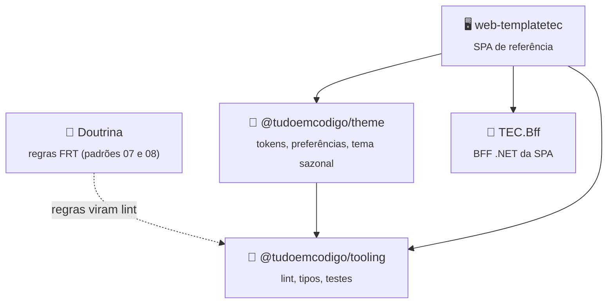

<div align="center">


[🏠 Tudo em Código](https://github.com/tudoemcodigo) › [📦 lib-tec-web](https://github.com/tudoemcodigo/lib-tec-web)

# 🧩 lib-tec-web

**Pacotes de frontend (React 19 + TypeScript) do ecossistema TEC: o que todo sistema repete (lint, tipos, testes, tema, UI, cliente HTTP) num lugar só, versionado e com as regras da Doutrina já embutidas.**

Monorepo npm · Um pacote por responsabilidade · SemVer por pacote · Regras FRT da Doutrina · Cobertura mínima de 90% · Node 24

[](https://github.com/tudoemcodigo/lib-tec-web/actions/workflows/ci.yml)
[](https://github.com/tudoemcodigo/lib-tec-web/blob/main/docs/compatibilidade.md)
[](https://github.com/tudoemcodigo/lib-tec-web/blob/main/docs/compatibilidade.md)
[](https://github.com/tudoemcodigo/lib-tec-web/blob/main/docs/compatibilidade.md)
[](https://github.com/tudoemcodigo/lib-tec-web/blob/main/CHANGELOG.md)
[](https://github.com/orgs/tudoemcodigo/packages)
[](https://github.com/tudoemcodigo/lib-tec-web/blob/main/LICENSE)

[📥 Instalação](#-instalação) · [🚀 Início rápido](#-início-rápido) · [📚 Documentação](https://github.com/tudoemcodigo/lib-tec-web/blob/main/docs/README.md) · [📝 Changelog](https://github.com/tudoemcodigo/lib-tec-web/blob/main/CHANGELOG.md)

</div>

---

## 📑 Sumário

- [✨ Por que usar](#-por-que-usar)
- [📦 Pacotes](#-pacotes)
- [🧬 Ecossistema TEC](#-ecossistema-tec)
- [📥 Instalação](#-instalação)
- [🚀 Início rápido](#-início-rápido)
- [📚 Documentação](#-documentação)
- [⚡ Compatibilidade](#-compatibilidade)
- [🛡️ Segurança · 🧪 Testes](#️-segurança--testes)
- [🤝 Contribuição · 🏷️ Versionamento · 📄 Licença](#-contribuição--versionamento--licença)

---

## ✨ Por que usar

| Sem lib-tec-web                                                                                         | Com lib-tec-web                                                                                                   |
| ------------------------------------------------------------------------------------------------------- | ----------------------------------------------------------------------------------------------------------------- |
| ESLint, `tsconfig`, Prettier e Vitest copiados em cada sistema, cada um de um jeito                     | Uma linha em cada arquivo de configuração; corrigir uma regra chega a todos os sistemas por atualização de versão |
| Regras da Doutrina (sem `fetch` solto, sem `innerHTML`, sem texto fora do catálogo) só na revisão de PR | As mesmas regras viram erro de lint, com o ID da regra na mensagem                                                |
| Cobertura "de 90%" que alguém baixa para o CI passar                                                    | O limiar **só sobe**: abaixo de 90 a configuração lança erro, e toda exclusão exige motivo                        |

- **Seguro por padrão**: sinks de XSS, escrita em storage e HTTP fora do módulo único são barrados no lint (FRT-SEG-01/04, FRT-API-02).
- **Testado de forma hostil**: o ESLint é provado com código hostil real, não só com exemplos felizes.
- **Pouca superfície**: nenhum script de instalação (`ignore-scripts=true`), `exports` por subcaminho e `files` em lista permitida.

---

## 📦 Pacotes

| Pacote                                                                                                            | Para que serve                                                                                                                                                 | Quando instalar             | Depende de                                                                              |
| ----------------------------------------------------------------------------------------------------------------- | -------------------------------------------------------------------------------------------------------------------------------------------------------------- | --------------------------- | --------------------------------------------------------------------------------------- |
| [`@tudoemcodigo/theme`](https://github.com/tudoemcodigo/lib-tec-web/blob/main/packages/theme/README.md)           | Tokens `--tec-*`, preferências de acessibilidade e tema sazonal por manifesto fechado                                                                          | Todo frontend TEC           | `react` (peer)                                                                          |
| [`@tudoemcodigo/i18n`](https://github.com/tudoemcodigo/lib-tec-web/blob/main/packages/i18n/README.md)             | Tradução ICU, escolha do idioma, catálogos combináveis e formatadores com locale explícito                                                                     | Todo frontend TEC           | `intl-messageformat`                                                                    |
| [`@tudoemcodigo/ui`](https://github.com/tudoemcodigo/lib-tec-web/blob/main/packages/ui/README.md)                 | Alertas, notificações, estados de erro/vazio/carga, cabeçalho de página, campos e diálogo padronizados                                                         | Todo frontend TEC           | `react`, `react-dom`, `@base-ui/react` (peers)                                          |
| [`@tudoemcodigo/shell`](https://github.com/tudoemcodigo/lib-tec-web/blob/main/packages/shell/README.md)           | Casca padrão: cabeçalho com nome do sistema, menu lateral, menu do usuário, paleta de comandos, aparência, atalhos e páginas de perfil, ajuda e acessibilidade | Todo frontend TEC com casca | `react`, `react-dom`, `@base-ui/react`, `@tanstack/react-router`, `ui`, `theme` (peers) |
| [`@tudoemcodigo/api-client`](https://github.com/tudoemcodigo/lib-tec-web/blob/main/packages/api-client/README.md) | Único cliente HTTP: timeout, retentativa segura, CSRF, idempotência, `ApiError` tipado e contrato validado                                                     | Todo frontend TEC           | `openapi-fetch`, `zod` (peers)                                                          |
| [`@tudoemcodigo/telemetry`](https://github.com/tudoemcodigo/lib-tec-web/blob/main/packages/telemetry/README.md)   | Telemetria sem dado pessoal: redação, rota parametrizada e destino do sistema                                                                                  | Todo frontend TEC           | nenhuma                                                                                 |
| [`@tudoemcodigo/tooling`](https://github.com/tudoemcodigo/lib-tec-web/blob/main/packages/tooling/README.md)       | ESLint com as regras FRT, `tsconfig` estrito, Prettier e Vitest com cobertura mínima                                                                           | Todo frontend TEC           | `eslint`, `typescript`, `prettier` (peers)                                              |

> [!NOTE]
> Os demais pacotes (`auth`, `testing`) estão **planejados** no [ADR 0008](https://github.com/tudoemcodigo/Doutrina/blob/main/familias/frontend/adr/0008-componentes-web-em-monorepo-npm-e-identificadores-em-ingles.md) e **ainda não existem**. Só se extrai para pacote o que o `web-templatetec` já usa e tem teste.

---

## 🧬 Ecossistema TEC



Legenda: seta cheia = dependência; tracejada = a Doutrina define a regra e o pacote a aplica. Os pacotes planejados entram aqui quando existirem.

---

## 📥 Instalação

Registro: **GitHub Packages** (`https://npm.pkg.github.com`). O escopo `@tudoemcodigo` é o nome da conta dona.

```ini
# ~/.npmrc (PAT com escopo read:packages; o token vem da variável, nunca do arquivo)
@tudoemcodigo:registry=https://npm.pkg.github.com
//npm.pkg.github.com/:_authToken=${GITHUB_TOKEN}
```

```bash
npm install --save-dev @tudoemcodigo/tooling
```

> [!WARNING]
> **Verificado** (2026-11-04): instalação do registro numa pasta limpa e atestado de procedência (SLSA) do tarball, que aponta o workflow `release.yml` da `main`. Para trabalhar no próprio monorepo, use o clone (veja [Início rápido](#-início-rápido)).

---

## 🚀 Início rápido

Requer Node 24 (`.nvmrc`) e npm 11. Do clone ao primeiro teste verde:

```bash
npm install          # ignore-scripts=true em .npmrc
npm run verify       # typecheck, lint, formatação, check:packages e testes com cobertura
```

Usar o `tooling` num sistema (são os mesmos arquivos que este repositório usa):

```js
// eslint.config.js
import { tecEslintConfig } from '@tudoemcodigo/tooling/eslint';

export default tecEslintConfig({
  tsconfigRootDir: import.meta.dirname,
  nodeFiles: ['*.config.js'],
});
```

```js
// prettier.config.js
export { default } from '@tudoemcodigo/tooling/prettier';
```

```js
// vitest.config.js
import { defineConfig } from 'vitest/config';
import { tecVitestConfig } from '@tudoemcodigo/tooling/vitest';

export default defineConfig(
  tecVitestConfig({ environment: 'node', include: ['test/**/*.test.js'] }),
);
```

| Script                   | Faz                                                                                                                       |
| ------------------------ | ------------------------------------------------------------------------------------------------------------------------- |
| `npm run typecheck`      | `tsc --noEmit` sobre os `.d.ts` públicos                                                                                  |
| `npm run lint`           | ESLint com `--max-warnings 0`                                                                                             |
| `npm run format:check`   | Prettier (`npm run format` corrige)                                                                                       |
| `npm run check:packages` | confere o `package.json` de cada pacote (escopo, `exports` com `types`, `files`, `sideEffects`, sem script de instalação) |
| `npm run build`          | compila os pacotes (`dist/`: JS, `.d.ts` e CSS)                                                                           |
| `npm test`               | Vitest com cobertura `v8` e limiar de 90% em linhas, instruções, funções e ramos                                          |
| `npm run e2e`            | Playwright nos três motores: o aplicador de tema sob CSP estrita                                                          |

---

## 📚 Documentação

| Arquivo                                                                                             | O que responde                                                   |
| --------------------------------------------------------------------------------------------------- | ---------------------------------------------------------------- |
| [📐 Uso](https://github.com/tudoemcodigo/lib-tec-web/blob/main/docs/uso.md)                         | Como ligar o `tooling` num sistema, passo a passo                |
| [⚙️ Opções](https://github.com/tudoemcodigo/lib-tec-web/blob/main/docs/opcoes.md)                   | Opção, padrão e efeito de `tecEslintConfig` e `tecVitestConfig`  |
| [❌ Erros](https://github.com/tudoemcodigo/lib-tec-web/blob/main/docs/erros.md)                     | Mensagem de lint ou de configuração, quando ocorre e o que fazer |
| [🎨 Tema e preferências](https://github.com/tudoemcodigo/lib-tec-web/blob/main/docs/tema.md)        | Tokens, atributos e preferências do `theme`                      |
| [🎄 Tema sazonal](https://github.com/tudoemcodigo/lib-tec-web/blob/main/docs/tema-sazonal.md)       | Manifesto, entrega, garantias e limites                          |
| [🛡️ Segurança](https://github.com/tudoemcodigo/lib-tec-web/blob/main/docs/seguranca.md)             | O que o lint cobre, o que não cobre e os riscos conhecidos       |
| [⚡ Compatibilidade](https://github.com/tudoemcodigo/lib-tec-web/blob/main/docs/compatibilidade.md) | Versões de Node, React, TypeScript, ESLint e Prettier            |

---

## ⚡ Compatibilidade

- **Node**: 24 (LTS), npm 11
- **TypeScript**: 5.9 (`>=5.9 <6`); **ESLint**: 9.39 (o `eslint-plugin-jsx-a11y` ainda não suporta o 10, FRT-BAS-03); **Prettier**: 3
- **Sistemas**: o monorepo é verificado no Windows (local) e no Linux (CI, Ubuntu); macOS **não verificado**

---

## 🛡️ Segurança · 🧪 Testes

- **Lint como controle**: as regras de segurança do frontend (FRT-SEG-01/04, FRT-API-02) viram erro de build; veja [Segurança](https://github.com/tudoemcodigo/lib-tec-web/blob/main/docs/seguranca.md) para os limites.
- **Supply chain**: `ignore-scripts=true`, `engine-strict`, `exports` por subcaminho e `files` em lista permitida (conferidos por `npm run check:packages`). `npm audit` acusa 1 advisory `moderate` na cadeia de desenvolvimento do ESLint (`minimatch`), sem correção sem salto de major: risco residual registrado.
- **Testes**: 189 unitários (Vitest, cobertura `v8` de 98,97% das instruções e 98,67% dos ramos sobre o `src` de todos os pacotes) e 42 E2E do `theme` em Chromium, Firefox e WebKit sob CSP estrita (`npm run e2e`). O gate de 90% é imposto pela própria configuração, que também recusa `coverageInclude` com curinga que mediria zero arquivos.

---

## 🤝 Contribuição · 🏷️ Versionamento · 📄 Licença

- **Contribuição**: PRs bem-vindos; rode `npm run verify` antes de abrir. Identificadores em inglês; comentários, mensagens e documentação em português. Veja o [AGENTS.md](https://github.com/tudoemcodigo/lib-tec-web/blob/main/AGENTS.md) para as regras de trabalho.
- **Versionamento**: [SemVer 2.0](https://semver.org/lang/pt-BR/) por pacote; enquanto for `0.0.1`, vale o ADR 0003 de Componentes. Publicação só pelo workflow de release, nunca da máquina de quem desenvolve.
- **Licença**: [Apache 2.0](https://github.com/tudoemcodigo/lib-tec-web/blob/main/LICENSE) — consulte `NOTICE` para atribuição.
