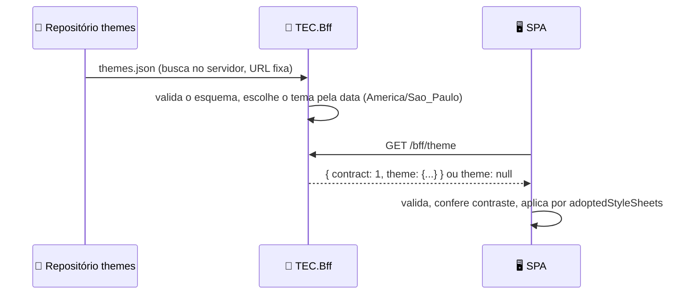

[🏠 lib-tec-web](https://github.com/tudoemcodigo/lib-tec-web/blob/main/README.md) › [📚 Documentação](https://github.com/tudoemcodigo/lib-tec-web/blob/main/docs/README.md) › 🎄 Tema sazonal

# 🎄 Tema sazonal por manifesto fechado

> Para quem publica temas, integra um sistema ou avalia o risco. Decisão e modelo de ameaças: ADR 0009 da família FRT da Doutrina; regras `FRT-TEM-01` a `08`.

## 📑 Sumário

- [🧭 Visão geral](#-visão-geral)
- [📄 O manifesto](#-o-manifesto)
- [🔌 Integrar no sistema](#-integrar-no-sistema)
- [🧪 Garantias](#-garantias)
- [❌ Erros e recusas](#-erros-e-recusas)
- [⚠️ Limites conhecidos](#️-limites-conhecidos)
- [❓ Perguntas frequentes](#-perguntas-frequentes)

## 🧭 Visão geral

Trocar a identidade para o Natal **sem republicar os sistemas** exige que a variação chegue em tempo de execução. Para ser seguro, ela é **dado**, nunca código: um JSON de esquema fechado, validado no servidor (`TEC.Bff`) e de novo na SPA.



Legenda: seta cheia = pedido; tracejada = resposta. Qualquer falha em qualquer passo deixa a SPA no tema padrão.

> [!IMPORTANT]
> **Estado nesta data:** o pacote `theme` (validação, contraste, aplicação, E2E) está pronto. O endpoint `GET /bff/theme` do `TEC.Bff` e o repositório `themes` seguem o contrato abaixo; confira o CHANGELOG deles para saber se já foram publicados.

## 📄 O manifesto

Documento publicado no repositório `themes` (contrato `1`). Fonte da verdade: [`themes.schema.json`](https://github.com/tudoemcodigo/lib-tec-web/blob/main/packages/theme/schema/themes.schema.json).

```json
{
  "contract": 1,
  "themes": [
    {
      "id": "christmas-2026",
      "from": "2026-12-01",
      "to": "2026-12-26",
      "tokens": {
        "color-accent": { "light": "#b3001b", "dark": "#ff9aa6" },
        "color-on-accent": { "light": "#ffffff", "dark": "#1a0004" }
      },
      "assets": { "banner": "banner.webp", "logo": "logo.png" },
      "animation": "snow"
    }
  ]
}
```

| Campo                          | Regra                                                                                                                                                                                               |
| ------------------------------ | --------------------------------------------------------------------------------------------------------------------------------------------------------------------------------------------------- |
| `contract`                     | Exatamente `1`; outro valor recusa o documento                                                                                                                                                      |
| `themes`                       | Até 64 temas; `id` único                                                                                                                                                                            |
| `id`                           | `^[a-z0-9][a-z0-9-]{0,63}$`                                                                                                                                                                         |
| `from`, `to`                   | Datas reais `AAAA-MM-DD`, inclusivas, `from <= to`, no fuso `America/Sao_Paulo`                                                                                                                     |
| `tokens`                       | Só os tokens trocáveis ([lista](https://github.com/tudoemcodigo/lib-tec-web/blob/main/docs/tema.md#-tokens)); cada um com `light` e `dark` em `#rrggbb` (nunca `url()`, `var()`, alfa ou 3 dígitos) |
| `assets.banner`, `assets.logo` | Nome de arquivo `png`, `webp` ou `avif`; **SVG proibido**; sem `/`, sem `..`                                                                                                                        |
| `animation`                    | `none` (padrão) ou `snow`                                                                                                                                                                           |

Com janelas sobrepostas vence o tema de **início mais recente**; no empate, o de menor `id`.

## 🔌 Integrar no sistema

```ts
import {
  loadSeasonalTheme,
  watchPreferencesForSeasonalTheme,
  useActiveSeasonalTheme,
} from '@tudoemcodigo/theme';

watchPreferencesForSeasonalTheme();
await loadSeasonalTheme((signal) => getTheme(signal)); // getTheme usa o cliente HTTP único do sistema
```

A casca lê banner e logo com `useActiveSeasonalTheme()` (URLs `/bff/theme/assets/<id>/<arquivo>`, da mesma origem). O texto alternativo vem do catálogo i18n, **nunca** do manifesto.

## 🧪 Garantias

| Garantia                                                           | Como é provada                                                                                                                    |
| ------------------------------------------------------------------ | --------------------------------------------------------------------------------------------------------------------------------- |
| Nenhum CSS, JS ou URL vindo do manifesto vira código               | Esquema fechado; `buildSeasonalCss` revalida token e cor e lança em dado hostil (teste)                                           |
| Aplicação não exige relaxar a CSP                                  | E2E em **Chromium, Firefox e WebKit** sob `style-src 'self'` sem `unsafe-inline`: aplica, e o detector de violações registra zero |
| `<style>` sem nonce e `setAttribute('style')` continuam bloqueados | E2E nos três motores (controle)                                                                                                   |
| Tokens de erro, aviso e sucesso não mudam                          | Fora da lista permitida; manifesto que os cita é recusado                                                                         |
| Contraste WCAG AA nos dois modos                                   | 24 pares verificados no CI do `themes` e **recalculados** na SPA, que recusa o tema reprovado                                     |
| Alto contraste e "sem tema sazonal" do usuário vencem              | Regra CSS `:not([data-contrast='high'])` e `seasonal: off` (E2E)                                                                  |
| Neve respeita movimento reduzido                                   | `prefers-reduced-motion` e `data-motion="reduced"` (E2E)                                                                          |
| Falha fechada                                                      | Rede fora, prazo, resposta inválida e contraste ruim: tema padrão (unitário e E2E)                                                |

## ❌ Erros e recusas

`loadSeasonalTheme` nunca lança; devolve `{ applied: false, reason }`:

| `reason`      | Quando                                                              | O que fazer                                         |
| ------------- | ------------------------------------------------------------------- | --------------------------------------------------- |
| `none`        | Sem tema ativo, falha de rede, prazo estourado ou resposta inválida | Nada: é o estado normal fora de datas comemorativas |
| `opt-out`     | A pessoa desligou o tema sazonal                                    | Nada: respeitar a preferência                       |
| `contrast`    | O tema reprova no contraste WCAG AA                                 | Corrigir as cores no repositório `themes`           |
| `unsupported` | O navegador não implementa `adoptedStyleSheets`                     | Nada: fica o tema padrão                            |

## ⚠️ Limites conhecidos

- **Não verificado:** a CSP real emitida pelo `TEC.Bff`; o E2E usa uma política equivalente.
- Sem assinatura do manifesto na v1: quem comprometer o repositório `themes` altera a **aparência**, dentro dos limites do esquema, e nada além disso (ADR 0009).
- Fontes não são trocáveis por tema.
- Não é uma defesa contra XSS no sistema: isso é papel da CSP e do lint (FRT-SEG-04/05).

## ❓ Perguntas frequentes

**O Natal precisa de deploy dos sistemas?** Não. É um PR no repositório `themes`; o `TEC.Bff` escolhe o tema pela data e os sistemas aplicam no próximo carregamento.

**Posso agendar o Natal com antecedência?** Sim: a janela (`from`/`to`) já define quando vale.

**A pessoa pode recusar o tema?** Sim, pela preferência `seasonal: off`; ela vale em todas as visitas.

---

⬅️ [Tema e preferências](https://github.com/tudoemcodigo/lib-tec-web/blob/main/docs/tema.md) · [Índice](https://github.com/tudoemcodigo/lib-tec-web/blob/main/docs/README.md)
