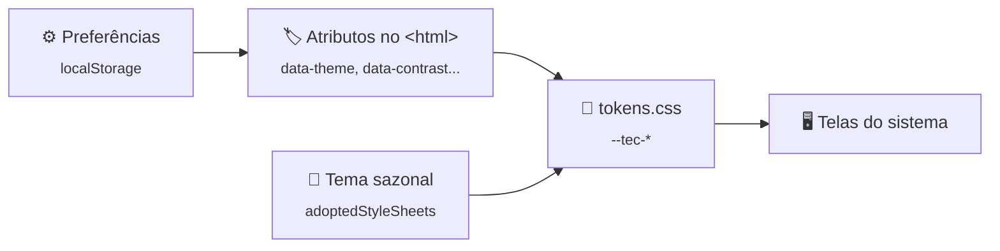

[🏠 lib-tec-web](https://github.com/tudoemcodigo/lib-tec-web/blob/main/README.md) › [📚 Documentação](https://github.com/tudoemcodigo/lib-tec-web/blob/main/docs/README.md) › 🎨 Tema e preferências

# 🎨 Tema e preferências

> Para quem escreve CSS e telas de um sistema TEC. O tema sazonal tem documento próprio: [Tema sazonal](https://github.com/tudoemcodigo/lib-tec-web/blob/main/docs/tema-sazonal.md).

## 📑 Sumário

- [🧭 Visão geral](#-visão-geral)
- [🎨 Tokens](#-tokens)
- [⚙️ Preferências](#️-preferências)
- [🔌 Ligar no sistema](#-ligar-no-sistema)
- [❓ Perguntas frequentes](#-perguntas-frequentes)

## 🧭 Visão geral

Toda cor do ecossistema é um token `--tec-*` definido por `light-dark(claro, escuro)`. O navegador escolhe o par pelo `color-scheme`: sem preferência, acompanha o sistema operacional; `data-theme="light"` ou `"dark"` no `<html>` fixa. O contraste alto troca a paleta inteira por uma de 9:1 ou mais (WCAG 1.4.6). Os tokens ficam na camada `tec-tokens`: CSS do sistema, sem camada, sempre vence.



Legenda: seta = "alimenta". O tema sazonal entra por cima dos tokens, exceto no alto contraste.

## 🎨 Tokens

| Grupo                      | Tokens (prefixo `--tec-`)                                                                                   | Trocável pelo tema sazonal           |
| -------------------------- | ----------------------------------------------------------------------------------------------------------- | ------------------------------------ |
| Superfícies e texto        | `color-bg`, `color-surface`, `color-text`, `color-text-muted`, `color-border`, `color-border-subtle`        | Sim                                  |
| Acento                     | `color-accent`, `color-on-accent`, `color-accent-subtle`                                                    | Sim                                  |
| Tabela                     | `color-table-header`, `color-row-hover`                                                                     | Sim                                  |
| Casca                      | `shell-bg`, `shell-hover`, `shell-active`, `shell-border`, `shell-text`, `shell-text-muted`, `shell-accent` | Sim                                  |
| Estado                     | `color-error`, `color-error-bg`, `color-success`, `color-warning`                                           | **Não** (protegidos)                 |
| Marca                      | `brand-blue`, `brand-indigo`, `brand-violet`, `brand-gradient`                                              | Não (decoração; reprovam como texto) |
| Tipografia, espaço e forma | `font-text`, `font-heading`, `font-code`, `space-1`…`space-8`, `radius`, `target-min`, `focus`              | Não                                  |

> [!WARNING]
> As cores vivas da marca (`brand-*`) reprovam como texto no contraste. Use-as só como decoração.

## ⚙️ Preferências

Estado único, validado ao ler e ao gravar; é a **única** escrita em `localStorage` (chave `tec.preferences.v1`, FRT-SEG-16).

| Preferência | Valores                      | Padrão    | Atributo no `<html>`        |
| ----------- | ---------------------------- | --------- | --------------------------- |
| `theme`     | `system`, `light`, `dark`    | `system`  | `data-theme`                |
| `textSize`  | `default`, `large`, `larger` | `default` | `data-text-size`            |
| `contrast`  | `default`, `high`            | `default` | `data-contrast`             |
| `motion`    | `system`, `reduced`          | `system`  | `data-motion`               |
| `shortcuts` | `true`, `false`              | `true`    | —                           |
| `seasonal`  | `on`, `off`                  | `on`      | — (controla o tema sazonal) |

Valor neutro remove o atributo. Valor fora do conjunto é recusado (`setPreferences` devolve `false` e nada muda); na leitura, cada campo inválido cai no padrão sem derrubar os outros, e texto guardado com mais de 512 caracteres é ignorado.

## 🔌 Ligar no sistema

```ts
import '@tudoemcodigo/theme/tokens.css';
import { initPreferences } from '@tudoemcodigo/theme';

initPreferences(); // antes de renderizar: sem flash de tema errado
```

```css
.card {
  color: var(--tec-color-text);
  background: var(--tec-color-surface);
  border: 1px solid var(--tec-color-border-subtle);
  border-radius: var(--tec-radius);
}
.card:focus-visible {
  outline: var(--tec-focus);
}
```

## ❓ Perguntas frequentes

**Meu CSS não sobrescreve o token.** O CSS do pacote está em `@layer tec-tokens`; o seu, sem camada, tem prioridade. Se você também usa camadas, declare-as depois de `tec-tokens`.

**Preciso de uma cor que não existe.** Crie o token no seu sistema (`--meu-sistema-...`) com `light-dark()`. Se for de uso geral, proponha o token ao pacote: ele entra no contrato (SemVer) e na paleta verificada.

---

⬅️ [Compatibilidade](https://github.com/tudoemcodigo/lib-tec-web/blob/main/docs/compatibilidade.md) · [Índice](https://github.com/tudoemcodigo/lib-tec-web/blob/main/docs/README.md) · ➡️ [Tema sazonal](https://github.com/tudoemcodigo/lib-tec-web/blob/main/docs/tema-sazonal.md)
